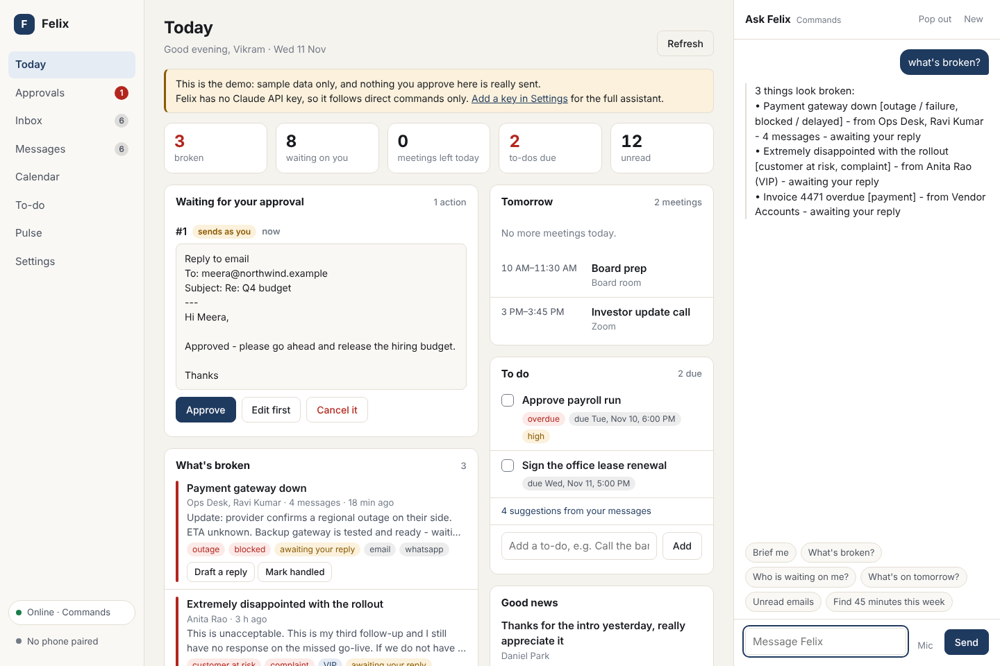
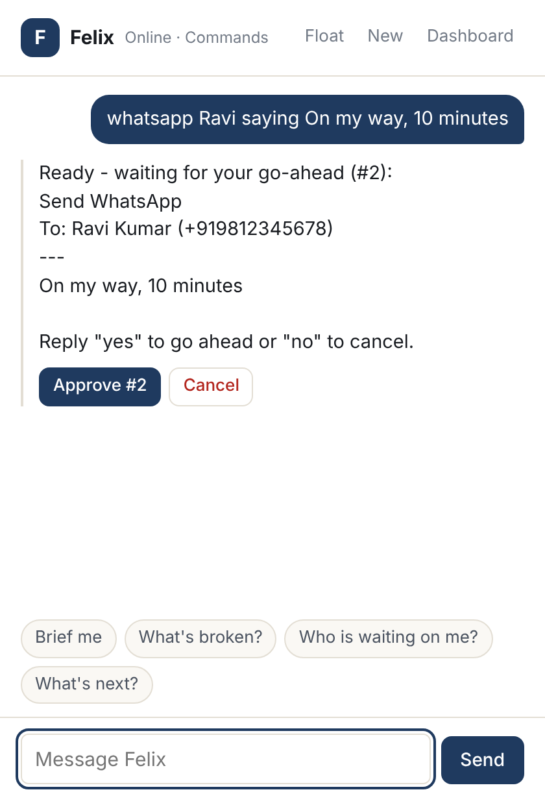

# Felix

Felix is a private executive assistant that runs on your own laptop and Android phone.
It reads and answers email and WhatsApp, manages your calendars, keeps your to-do list,
tells you what is happening and what looks broken, and sends you a brief every morning
and every night. It works with or without the internet, and nothing is sent in your name
until you say so.



## What it does

| | With internet | Without internet |
|---|---|---|
| **Understanding you** | Anything you ask, through Claude | Direct commands (about 75 kinds: "what's broken", "reply to Anita saying ...", "find 45 minutes this week") or a local model through Ollama |
| **Email** | Reads, summarises, drafts and sends | Reads what is already synced; replies wait in a queue and go out when the connection returns |
| **Calendar** | Felix's own calendar, ICS feeds, Google Calendar (two-way), the phone's calendars | Everything already synced; changes to Felix's own calendar |
| **WhatsApp** | Reads and replies through your phone, a linked device, or both | Reads what has arrived; replies wait in the queue |
| **What's happening / what's broken** | Ranked from the tone and urgency of your mail and messages | Same: the analysis runs on the laptop |
| **Morning and evening brief** | To your WhatsApp, with a phone notification, email and a desktop notice as fallbacks | Composed and stored; delivered when a route is available |
| **Laptop and phone control** | Open apps, find files, volume, lock, screenshots, shell commands; calls, texts, alarms, torch, find-my-phone | Same (the phone must be reachable on your network) |

Felix is one person's assistant. It keeps everything in a folder on your laptop and talks
to the outside world only through the accounts you connect.

## Try it in two minutes

You need Python 3.10 or newer.

```bash
git clone https://github.com/ChiranjeeviChandan/VK_Account.git
```

```bash
cd VK_Account
```

```bash
./scripts/install.sh
```

```bash
felix demo
```

`felix demo` opens the dashboard on sample data: an outage, an unhappy customer, a
draft reply waiting for approval. Nothing in the demo can be sent anywhere. On Windows,
run `scripts\install.ps1` in PowerShell instead of the shell script.

## Set it up for real

```bash
felix setup
```

```bash
felix start
```

`felix setup` asks for your name, time zone, WhatsApp number and brief times, and offers
to add a Claude API key and your email. `felix start` runs Felix and opens the dashboard,
which shows what is still left to connect. [docs/SETUP.md](docs/SETUP.md) walks through
every step: email (including Gmail and Microsoft 365), calendars, the Android app,
WhatsApp, starting at login and running without the internet.

## How you use it

- **Dashboard** (`felix open`): today, approvals, inbox, messages, calendar, to-do,
  pulse and settings, with a chat column on every page.
- **Overlay** (`felix overlay`, or "Pop out" in the dashboard): a small command bar that
  floats above your other windows. On the phone, the Felix bubble does the same.
- **WhatsApp**: with the linked-device bridge, type to Felix in your own "Message
  yourself" chat and it answers there.
- **Terminal**: `felix ask "what's on tomorrow"`, or just `felix` to chat.



## You stay in control

- Sending email, WhatsApp or SMS, placing calls, inviting people to meetings, running
  shell commands and changing or deleting files all wait for your approval. You see
  exactly what will be sent and can edit it first. You choose in Settings what Felix may
  do without asking; shell commands, deletions and power actions always ask.
- Approval can only come from you: the dashboard, the overlay, the paired phone, or a
  plain "yes" in your chat with Felix. The language model cannot approve anything.
- Actions that change the laptop itself (shell commands, writing or deleting files,
  power) can be approved only at the laptop unless you decide otherwise, so a lost phone
  cannot run commands on it.
- Text written by other people (mail, messages, web pages) is treated as information,
  not as instructions, and anything it might talk Felix into still stops at your
  approval.
- Everything Felix does or asks to do is written to an activity log you can read in
  Settings.

[docs/SECURITY.md](docs/SECURITY.md) explains the design, what leaves your laptop and
what the limits are.

## What has and has not been tested

Felix was built without access to real accounts or a phone, so be clear about what is
proven and what is not.

**Tested**

- The Python core: about 400 automated tests, run on every push on Linux (Python 3.10,
  3.11, 3.12 and 3.13), macOS and Windows. They include email against local IMAP and
  SMTP servers, the phone link over real sockets with a pinned certificate, the HTTP
  API, and `felix demo` run as a real process and driven from the command line.
- The dashboard and the browser overlay, driven in Chromium against the demo: every
  page, the chat, approvals, light and dark themes, phone width, and the floating
  window.
- The WhatsApp bridge logic: 16 tests with a scripted connection, plus a test that runs
  the Python core against that code end to end.
- The Android app: it builds into an APK on GitHub Actions and its 63 unit tests pass
  there.
- The installers: on every push each one sets Felix up on a fresh Linux, macOS or
  Windows machine, and the installed `felix` then answers commands and passes
  `felix doctor`.

**Not tested, so expect to find rough edges**

- Claude: tested through the real SDK against a scripted server, not against the live
  API.
- Gmail, Microsoft 365, Google Calendar and the WhatsApp Business Cloud API: tested
  against local stand-ins only.
- WhatsApp itself: neither the linked-device bridge nor the phone app has been run
  against a real account. The bridge has never been started with the real WhatsApp
  library.
- The Android app has never been run on a phone. Everything that depends on a real
  device (notification formats of each messenger, the WhatsApp send flow, manufacturer
  battery savers) still has to be confirmed on yours.
- Laptop control on a real desktop: file and shell actions are tested for real, but for
  actions that need a desktop session (notifications, opening apps, volume, screenshots,
  locking) the tests only check which command Felix would give Linux, macOS or Windows.
  None of them has been watched working on a screen, and nothing at all has been tried
  by hand on Windows or macOS.
- The Tk desktop overlay (`felix overlay`): its logic is tested with a stand-in for the
  window toolkit; it has not been seen on a screen. The browser overlay has.

## Repository layout

```
felix/                  the core (Python, standard library first)
  brain/                Claude, a local model, and the offline command engine
  connectors/           email, calendars, OAuth sign-in, news feeds
  insights/             tone and urgency analysis, the "pulse", suggested to-dos
  phone/                the link to the Android app
  whatsapp/             the three WhatsApp routes and the linked-device bridge
  control/              laptop control for Windows, macOS and Linux
  server/               the local web server and the dashboard
android/                Felix Companion, the Android app
docs/                   setup, security, WhatsApp, architecture, phone protocol
scripts/                installers
tests/                  the test suite
```

More detail is in [docs/ARCHITECTURE.md](docs/ARCHITECTURE.md).

## Running the tests

```bash
pip install -e ".[dev]"
```

```bash
pytest
```

```bash
node --test "felix/whatsapp/sidecar/test/*.test.js"
```
