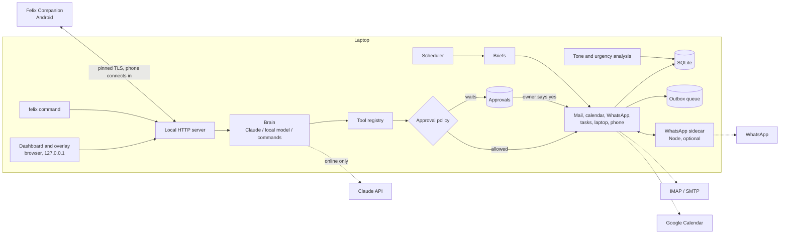

# How Felix is built

Felix is one Python process on the laptop (the Core), one Android app, and an optional
Node sidecar for WhatsApp. The Core depends on the Python standard library first; every
third-party package is optional and Felix keeps working without it.



## The pieces

| Module | What it does |
|---|---|
| `felix/app.py` | Builds every service and wires them together. One `Felix` object per data folder. |
| `felix/store.py` | SQLite (WAL mode) with a full-text index over mail, messages, tasks, notes and events. One connection per thread, one writer at a time. |
| `felix/config.py`, `felix/secrets.py`, `felix/paths.py` | Settings (JSON), secrets (OS keychain or a private file), and where the data folder is on each system. |
| `felix/net.py` | Decides whether Felix is online: automatic (probes), forced online, forced offline. |
| `felix/tools.py` | The tool registry: every capability is a named tool with a JSON schema, a risk level and a preview of what it would do. |
| `felix/policy.py` | Decides whether a tool call runs, waits for approval or is refused, and records approvals. |
| `felix/outbox.py` | The queue for everything that is sent. Items wait while offline and go out in order, once. |
| `felix/brain/` | `core.py` routes each message; `claude.py` is the online engine; `local.py` talks to Ollama; `rules.py` is the offline command engine; `prompts.py` holds the instructions. |
| `felix/insights/` | `sentiment.py` scores tone and urgency with a lexicon; `pulse.py` groups messages into issues and ranks what is broken; `actions.py` finds requests addressed to you. |
| `felix/connectors/` | `mail.py` (IMAP and SMTP), `oauth.py`, `calendar.py` with `rrule.py` and `ics.py`, `calendar_google.py`, `feeds.py`. |
| `felix/phone/hub.py` | Pairing, the command queue to the phone and the events coming back. |
| `felix/whatsapp/` | `service.py` unifies the three routes; `bridge.py` supervises the Node sidecar in `sidecar/`; `cloud.py` is the Business Cloud API. |
| `felix/control/` | Laptop control. `platform.py` maps each action to the right command on Windows, macOS and Linux. |
| `felix/briefing.py`, `felix/scheduler.py` | Compose and deliver briefs; reminders, meeting alerts, catch-up after sleep. |
| `felix/server/` | `http.py` is a small HTTP layer on the standard library; `api.py` is the API; `static/` is the dashboard. |
| `felix/cli.py`, `felix/client.py`, `felix/overlay.py`, `felix/demo.py` | The `felix` command, its client for a running Core, the Tk overlay, and the sample data. |
| `android/` | Felix Companion. Framework APIs only; see `android/README.md`. |

## How a request flows

**"Reply to Anita saying we will fix it today"**, typed in the dashboard:

1. The dashboard posts the text to `/api/chat/stream`.
2. `Brain.respond` first checks whether the text is a plain yes or no to something
   waiting (`Policy.handle_reply`). It is not.
3. If the text is an instant command (torch, volume, "what's next"), the command engine
   answers at once. Otherwise the best available engine takes it: Claude online, a local
   model if one is running, the command engine otherwise.
4. The engine calls the tool `email_reply`. The registry validates the arguments and asks
   the policy. Sending email is set to "ask", so the registry stores an approval with a
   preview and returns "awaiting approval" instead of sending.
5. The dashboard shows the preview. You press Approve. `Policy.approve` runs the tool
   again, this time marked as approved.
6. `Mail.queue_send` puts the message in the outbox and tries to deliver it. Offline, it
   stays there; when the connection returns the outbox delivers it.
7. After sending, a copy is filed in Sent, the original is marked answered, and the
   issue stops counting as "waiting on you".

**A WhatsApp message arriving through the phone:**

1. Android shows the notification. The Companion app's notification listener turns it
   into an event and posts it to the Core.
2. `PhoneHub.ingest` stores it through `WhatsApp.receive`, which files the message,
   updates the chat and hands the text to the pulse.
3. `Pulse.ingest` scores tone and urgency, decides whether it needs a reply, attaches it
   to an existing issue or starts a new one, and may suggest a to-do.
4. The dashboard hears about it over its event stream and refreshes.

## Three engines, one set of tools

Every engine works through the same tool registry, so the approval rules cannot differ
between them.

- **Claude** (`brain/claude.py`) uses the official SDK's tool runner with streaming.
  Tools are passed with their JSON schemas; the system prompt is fixed so it caches.
- **A local model** (`brain/local.py`) uses Ollama's chat API with the same tools and a
  shorter prompt.
- **The command engine** (`brain/rules.py`) matches about 75 kinds of request with
  patterns and calls the same tools. It needs nothing but the laptop, and it never
  guesses: what it does not recognise, it says so.

If Claude cannot be reached mid-conversation, Felix falls back down that list and says
why.

## Storage

One SQLite file, `felix.db`. The main tables: `emails`, `chats` and `messages`,
`notifications`, `events`, `tasks`, `notes` (memory), `contacts`, `signals` (the tone and
urgency of each message), `outbox`, `approvals`, `audit`, `conversations` and `turns`
(chat history), `devices` and `phone_commands`, `briefs`, `feed_items`, and a full-text
table `search`.

## The phone protocol

The phone always connects to the laptop, never the other way round: it posts events,
long-polls for commands and posts results. That works behind home routers and survives
the phone changing networks. The full contract is in
[PHONE_PROTOCOL.md](PHONE_PROTOCOL.md).

## The WhatsApp sidecar protocol

The Core starts the sidecar as a child process and exchanges one JSON object per line
over its standard input and output; no port is opened. The message types are listed at
the top of `felix/whatsapp/sidecar/bridge.js`.

## Adding to Felix

**A new capability** is a tool. Register it from a service's `register` method:

```python
@tools.tool(
    "task_add",
    "Add an item to the owner's to-do list.",
    {"title": {"type": "string"}, "due": {"type": "string"}},   # the arguments, as JSON Schema properties
    ["title"],                                                  # which of them are required
    risk=LOCAL, group="tasks",
)
def task_add(args, ctx):
    ...
```

Choose the risk honestly: `READ`, `LOCAL`, `OUTBOUND` (speaks for the owner) or `DANGER`.
All three engines can use it at once. Give outbound tools a `preview` and a `recipients`
function so the approval shows what will happen and to whom.

**A new offline command** is an intent in `brain/rules.py`: a pattern plus a function
that calls tools and formats the answer. Add the phrasing to `tests/test_rules.py`.

## Tests

- `tests/` runs with `pytest` and needs no network or accounts. External services are
  replaced by small stand-ins in `tests/fakes/` that speak the real protocols over real
  sockets: an IMAP and SMTP server, a simulated phone, a scripted Claude API, a WhatsApp
  sidecar.
- `felix/whatsapp/sidecar/test/` runs with `node --test`.
- `android/app/src/test/` runs with Gradle. `android/tools/typecheck` type-checks the
  app without the Android SDK.
- Time is injected (`FixedClock`), so tests about briefs, reminders and "tomorrow at 3"
  are deterministic.
